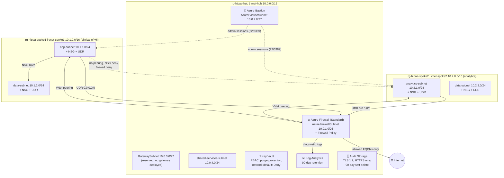

# ☁️ Lab: HIPAA-Aligned Hub and Spoke Network on Azure


A hub and spoke network built entirely in Terraform. A central hub provides shared security services (Azure Firewall, Bastion, Key Vault, centralized logging). Two isolated spokes host clinical (ePHI) and analytics (de-identified) workloads, with all egress and cross-spoke traffic forced through the firewall.

---

## 📌 Overview

Organizations that handle electronic Protected Health Information (ePHI) must implement the technical safeguards in HIPAA §164.312: access control, audit controls, integrity, transmission security, and encryption. Hub and spoke is the standard way to meet these at scale. Instead of bolting controls onto each workload, the hub supplies firewall inspection, audit logging, secret management, and administrative access once, and every spoke inherits them.

**Topology**

- **Hub:** Azure Firewall, Azure Bastion, Key Vault, Log Analytics, audit storage.
- **Spoke 1 (clinical):** workloads that touch raw ePHI. No public IPs, no direct internet path.
- **Spoke 2 (analytics):** workloads on de-identified data, in a separate VNet and resource group.
- Spokes peer to the hub but **not to each other**. The only path between them is through the firewall, where it is inspected and logged.

| Detail | Value |
|---|---|
| **Difficulty** | Intermediate to Advanced |
| **Time to complete** | 4 to 5 hours |
| **Cost** | High while running. Azure Firewall alone is about $1.25/hour (roughly $30/day), plus Bastion. Deploy, validate, and destroy in the same session. Confirm current rates in the Azure pricing calculator. |
| **Cloud Provider** | Microsoft Azure |
| **Core Services** | Azure Firewall (Standard) + Firewall Policy, VNet Peering, NSGs, UDRs, Bastion, Key Vault, Log Analytics, Defender for Cloud, Azure Policy |
| **Tooling** | Terraform 1.5+, `azurerm ~> 3.0`, Azure CLI |

> **Scope:** This lab implements the **technical network controls**. A production HIPAA environment also requires Business Associate Agreements (BAAs), written policies, physical safeguards, workforce training, and organizational controls. Deploying these resources does not make an environment "HIPAA compliant" by itself, which is why this lab is described as HIPAA-**aligned**.

---

## 🏗️ Architecture



**How it works:**

1. Spokes are peered to the hub only. There is no spoke-to-spoke peering.
2. A user-defined route (UDR) on every spoke subnet sends `0.0.0.0/0` to the firewall's private IP. Peering alone does not force traffic through the firewall; without the UDR, traffic would follow Azure's default system routes and bypass inspection entirely.
3. The firewall policy allows only a short list of Azure FQDNs over HTTPS and explicitly denies spoke-to-spoke traffic.
4. NSGs on every spoke subnet deny internet inbound and cross-spoke inbound as a second, independent layer.
5. Firewall logs go to a single Log Analytics workspace with 90-day retention.

### What Gets Built

```
rg-hipaa-hub-<yourname>
├── vnet-hub                10.0.0.0/16
│   ├── AzureFirewallSubnet     10.0.1.0/26
│   ├── AzureBastionSubnet      10.0.2.0/27
│   ├── GatewaySubnet           10.0.3.0/27
│   └── shared-services-subnet  10.0.4.0/24
├── Azure Firewall (Standard) + Public IP + Firewall Policy
├── Azure Bastion (Standard) + Public IP
├── Key Vault (RBAC, soft delete, purge protection)
├── Log Analytics Workspace (90-day retention)
└── Storage Account (audit archive)

rg-hipaa-spoke1-<yourname>      clinical ePHI
├── vnet-spoke1             10.1.0.0/16
│   ├── app-subnet              10.1.1.0/24   + NSG + route table
│   └── data-subnet             10.1.2.0/24   + NSG + route table
└── Peering to hub

rg-hipaa-spoke2-<yourname>      analytics (de-identified)
├── vnet-spoke2             10.2.0.0/16
│   ├── analytics-subnet        10.2.1.0/24   + NSG + route table
│   └── data-subnet             10.2.2.0/24   + NSG + route table
└── Peering to hub

Subscription level
├── Defender for Cloud plans: Virtual Machines, Storage Accounts, Key Vaults
└── Azure Policy assignment: built-in HIPAA initiative
```

---

## 🛡️ HIPAA §164.312 Control Mapping

This table is deliberately split into what the lab **deploys** and what it does **not**, so the claims match the code.

| §164.312 Safeguard | Implemented in this lab | Not implemented (production addition) |
|---|---|---|
| **Access Control** (a)(1) | Entra ID RBAC on Key Vault; Bastion for admin access with no public IPs on workloads; no shared credentials | Automatic logoff and unique user IDs are enforced at the OS and application layer, outside this lab |
| **Audit Controls** (b) | Central Log Analytics workspace (90 days); Azure Firewall diagnostic logs; audit storage account with 90-day soft delete | Flow logs (see [Flow Logs](#-flow-logs-and-the-nsg-retirement)); diagnostic settings on every resource as workloads are added |
| **Integrity** (c)(1) | Key Vault soft delete (90 days) and purge protection; blob soft delete on audit storage | Immutable (WORM) storage policy; Transparent Data Encryption (no SQL deployed) |
| **Transmission Security** (e)(1) | TLS 1.2 minimum and HTTPS-only on storage; firewall egress restricted to an FQDN allowlist; no public IPs in spokes; Key Vault network default action `Deny` | Private endpoints for Key Vault and data services |
| **Encryption** (a)(2)(iv), (e)(2)(ii) | Storage Service Encryption (platform-managed keys, on by default) | Customer-managed keys in Key Vault; TDE on SQL |
| **Network Segmentation** (addressable) | Hub and spoke; NSGs on all four spoke subnets; firewall inspects egress and cross-spoke traffic; no spoke-to-spoke peering | None for this scope |
| **Threat Detection** (addressable) | Defender for Cloud plans (VMs, Storage, Key Vaults); built-in HIPAA policy initiative assigned | Alert routing and an incident response runbook |

---

## ✅ Prerequisites

| Requirement | Verify |
|---|---|
| Azure CLI, authenticated | `az account show` |
| Terraform 1.5+ | `terraform -version` |
| Active subscription | `az account list --output table` |
| Owner, or Contributor + User Access Administrator | `az role assignment list --assignee $(az account show --query user.name -o tsv)` |

Owner-level rights are needed because the lab creates role assignments and a subscription-level policy assignment.

> ⚠️ **Subscription-wide effects.** The Defender plans and the policy assignment apply to the **whole subscription**, not just this lab's resource groups. Use a lab or sandbox subscription.

---

## 🚀 Deployment Steps

### Part 1: Project Structure

**Mac / Linux**
```bash
mkdir -p ~/repos/hipaa-hub-spoke && cd ~/repos/hipaa-hub-spoke
touch main.tf variables.tf outputs.tf terraform.tfvars
cat > .gitignore << 'EOF'
terraform.tfvars
*.tfstate
*.tfstate.backup
.terraform/
.terraform.lock.hcl
*.tfplan
EOF
```

**Windows (PowerShell)**
```powershell
New-Item -ItemType Directory -Force -Path "$HOME\repos\hipaa-hub-spoke" | Out-Null
cd "$HOME\repos\hipaa-hub-spoke"
New-Item -ItemType File main.tf, variables.tf, outputs.tf, terraform.tfvars
@("terraform.tfvars","*.tfstate","*.tfstate.backup",".terraform/",".terraform.lock.hcl","*.tfplan") | Set-Content .gitignore
```

### Part 2: `variables.tf`

Each variable is written on multiple lines. HCL does not allow several arguments on one line, so the compact one-line form fails `terraform validate`.

```hcl
variable "yourname" {
  description = "Name suffix for all resources. Lowercase, no spaces."
  type        = string
}

variable "location" {
  description = "Azure region for all resources."
  type        = string
  default     = "eastus2"
}

variable "tags" {
  description = "Tags applied to all resources."
  type        = map(string)
  default = {
    project     = "hipaa-hub-spoke"
    environment = "lab"
    managed_by  = "terraform"
    compliance  = "hipaa"
  }
}

# Hub address space
variable "hub_address_space" {
  type    = string
  default = "10.0.0.0/16"
}

variable "hub_firewall_subnet" {
  type    = string
  default = "10.0.1.0/26"
}

variable "hub_bastion_subnet" {
  type    = string
  default = "10.0.2.0/27"
}

variable "hub_gateway_subnet" {
  type    = string
  default = "10.0.3.0/27"
}

variable "hub_shared_subnet" {
  type    = string
  default = "10.0.4.0/24"
}

# Spoke 1: clinical ePHI
variable "spoke1_address_space" {
  type    = string
  default = "10.1.0.0/16"
}

variable "spoke1_app_subnet" {
  type    = string
  default = "10.1.1.0/24"
}

variable "spoke1_data_subnet" {
  type    = string
  default = "10.1.2.0/24"
}

# Spoke 2: analytics
variable "spoke2_address_space" {
  type    = string
  default = "10.2.0.0/16"
}

variable "spoke2_app_subnet" {
  type    = string
  default = "10.2.1.0/24"
}

variable "spoke2_data_subnet" {
  type    = string
  default = "10.2.2.0/24"
}
```

### Part 3: `terraform.tfvars`

```hcl
yourname = "reco"
location = "eastus2"
```

`yourname` is used in globally unique names (Key Vault, storage), so keep it short: lowercase letters and digits only.

### Part 4: `main.tf`

Paste the sections below in order.

**Provider**
```hcl
terraform {
  required_providers {
    azurerm = {
      source  = "hashicorp/azurerm"
      version = "~> 3.0"
    }
  }
}

provider "azurerm" {
  features {
    key_vault {
      purge_soft_delete_on_destroy    = true
      recover_soft_deleted_key_vaults = true
    }
  }
}

data "azurerm_client_config" "current" {}
```

**Resource groups**
```hcl
resource "azurerm_resource_group" "hub" {
  name     = "rg-hipaa-hub-${var.yourname}"
  location = var.location
  tags     = var.tags
}

resource "azurerm_resource_group" "spoke1" {
  name     = "rg-hipaa-spoke1-${var.yourname}"
  location = var.location
  tags     = var.tags
}

resource "azurerm_resource_group" "spoke2" {
  name     = "rg-hipaa-spoke2-${var.yourname}"
  location = var.location
  tags     = var.tags
}
```

**Log Analytics workspace (centralized audit logging).** 90 days is the minimum used here to support §164.312(b); production should retain 365 days or more.
```hcl
resource "azurerm_log_analytics_workspace" "hub" {
  name                = "law-hipaa-${var.yourname}"
  location            = azurerm_resource_group.hub.location
  resource_group_name = azurerm_resource_group.hub.name
  sku                 = "PerGB2018"
  retention_in_days   = 90
  tags                = var.tags
}
```

**Audit storage account.** TLS 1.2 minimum and HTTPS-only are transmission security controls; soft delete protects audit data from accidental or malicious deletion.
```hcl
resource "azurerm_storage_account" "audit" {
  name                       = "sthipaaaudit${var.yourname}"
  resource_group_name        = azurerm_resource_group.hub.name
  location                   = azurerm_resource_group.hub.location
  account_tier               = "Standard"
  account_replication_type   = "LRS"
  min_tls_version            = "TLS1_2"
  https_traffic_only_enabled = true

  blob_properties {
    delete_retention_policy {
      days = 90
    }
  }

  tags = var.tags
}
```

**Key Vault.** RBAC authorization, soft delete, and purge protection prevent keys from being destroyed accidentally or maliciously. The network ACL denies by default.
```hcl
resource "azurerm_key_vault" "hub" {
  name                       = "kv-hipaa-${var.yourname}"
  location                   = azurerm_resource_group.hub.location
  resource_group_name        = azurerm_resource_group.hub.name
  tenant_id                  = data.azurerm_client_config.current.tenant_id
  sku_name                   = "standard"
  enable_rbac_authorization  = true
  soft_delete_retention_days = 90
  purge_protection_enabled   = true

  network_acls {
    default_action = "Deny"
    bypass         = "AzureServices"
  }

  tags = var.tags
}

resource "azurerm_role_assignment" "kv_admin" {
  scope                = azurerm_key_vault.hub.id
  role_definition_name = "Key Vault Administrator"
  principal_id         = data.azurerm_client_config.current.object_id
}
```

**Hub VNet and subnets.** `AzureFirewallSubnet` (minimum /26) and `AzureBastionSubnet` (minimum /27) must use exactly these names.
```hcl
resource "azurerm_virtual_network" "hub" {
  name                = "vnet-hub-${var.yourname}"
  location            = azurerm_resource_group.hub.location
  resource_group_name = azurerm_resource_group.hub.name
  address_space       = [var.hub_address_space]
  tags                = var.tags
}

resource "azurerm_subnet" "hub_firewall" {
  name                 = "AzureFirewallSubnet"
  resource_group_name  = azurerm_resource_group.hub.name
  virtual_network_name = azurerm_virtual_network.hub.name
  address_prefixes     = [var.hub_firewall_subnet]
}

resource "azurerm_subnet" "hub_bastion" {
  name                 = "AzureBastionSubnet"
  resource_group_name  = azurerm_resource_group.hub.name
  virtual_network_name = azurerm_virtual_network.hub.name
  address_prefixes     = [var.hub_bastion_subnet]
}

resource "azurerm_subnet" "hub_gateway" {
  name                 = "GatewaySubnet"
  resource_group_name  = azurerm_resource_group.hub.name
  virtual_network_name = azurerm_virtual_network.hub.name
  address_prefixes     = [var.hub_gateway_subnet]
}

resource "azurerm_subnet" "hub_shared" {
  name                 = "shared-services-subnet"
  resource_group_name  = azurerm_resource_group.hub.name
  virtual_network_name = azurerm_virtual_network.hub.name
  address_prefixes     = [var.hub_shared_subnet]
}
```

**Azure Firewall and Firewall Policy.** The firewall is the inspection point for spoke egress and cross-spoke traffic.

> **Important:** the firewall must be explicitly associated with the policy through `firewall_policy_id`. Creating a policy without attaching it leaves the firewall with no rules, so everything is blocked and none of the rules below take effect.

```hcl
resource "azurerm_public_ip" "firewall" {
  name                = "pip-firewall-${var.yourname}"
  location            = azurerm_resource_group.hub.location
  resource_group_name = azurerm_resource_group.hub.name
  allocation_method   = "Static"
  sku                 = "Standard"
  tags                = var.tags
}

resource "azurerm_firewall_policy" "hub" {
  name                = "fwpol-hipaa-${var.yourname}"
  resource_group_name = azurerm_resource_group.hub.name
  location            = azurerm_resource_group.hub.location
  sku                 = "Standard"
  tags                = var.tags
}

resource "azurerm_firewall" "hub" {
  name                = "fw-hipaa-${var.yourname}"
  location            = azurerm_resource_group.hub.location
  resource_group_name = azurerm_resource_group.hub.name
  sku_name            = "AZFW_VNet"
  sku_tier            = "Standard"
  firewall_policy_id  = azurerm_firewall_policy.hub.id
  tags                = var.tags

  ip_configuration {
    name                 = "configuration"
    subnet_id            = azurerm_subnet.hub_firewall.id
    public_ip_address_id = azurerm_public_ip.firewall.id
  }
}

resource "azurerm_monitor_diagnostic_setting" "firewall" {
  name                       = "diag-firewall"
  target_resource_id         = azurerm_firewall.hub.id
  log_analytics_workspace_id = azurerm_log_analytics_workspace.hub.id

  enabled_log { category = "AzureFirewallApplicationRule" }
  enabled_log { category = "AzureFirewallNetworkRule" }
  enabled_log { category = "AzureFirewallDnsProxy" }

  metric {
    category = "AllMetrics"
    enabled  = true
  }
}

resource "azurerm_firewall_policy_rule_collection_group" "main" {
  name               = "rcg-hipaa"
  firewall_policy_id = azurerm_firewall_policy.hub.id
  priority           = 100

  # Allow HTTPS egress to a short list of Azure FQDNs; everything else is denied by default
  application_rule_collection {
    name     = "allow-azure-services"
    priority = 100
    action   = "Allow"

    rule {
      name              = "allow-azure-monitor"
      source_addresses  = ["10.1.0.0/16", "10.2.0.0/16"]
      destination_fqdns = ["*.ods.opinsights.azure.com", "*.oms.opinsights.azure.com", "*.monitoring.azure.com"]
      protocols {
        type = "Https"
        port = 443
      }
    }

    rule {
      name              = "allow-azure-updates"
      source_addresses  = ["10.1.0.0/16", "10.2.0.0/16"]
      destination_fqdns = ["*.windowsupdate.microsoft.com", "*.update.microsoft.com"]
      protocols {
        type = "Https"
        port = 443
      }
    }
  }

  # Explicitly deny spoke-to-spoke traffic
  network_rule_collection {
    name     = "deny-spoke-to-spoke"
    priority = 200
    action   = "Deny"

    rule {
      name                  = "deny-spoke1-to-spoke2"
      source_addresses      = ["10.1.0.0/16"]
      destination_addresses = ["10.2.0.0/16"]
      protocols             = ["Any"]
      destination_ports     = ["*"]
    }

    rule {
      name                  = "deny-spoke2-to-spoke1"
      source_addresses      = ["10.2.0.0/16"]
      destination_addresses = ["10.1.0.0/16"]
      protocols             = ["Any"]
      destination_ports     = ["*"]
    }
  }
}
```

**Azure Bastion.** Provides administrative access to spoke VMs without public IPs; sessions are authenticated through the Azure portal and logged.
```hcl
resource "azurerm_public_ip" "bastion" {
  name                = "pip-bastion-${var.yourname}"
  location            = azurerm_resource_group.hub.location
  resource_group_name = azurerm_resource_group.hub.name
  allocation_method   = "Static"
  sku                 = "Standard"
  tags                = var.tags
}

resource "azurerm_bastion_host" "hub" {
  name                = "bastion-hipaa-${var.yourname}"
  location            = azurerm_resource_group.hub.location
  resource_group_name = azurerm_resource_group.hub.name
  sku                 = "Standard"
  tags                = var.tags

  ip_configuration {
    name                 = "configuration"
    subnet_id            = azurerm_subnet.hub_bastion.id
    public_ip_address_id = azurerm_public_ip.bastion.id
  }
}
```

**Spoke 1: clinical ePHI network.** The data tier accepts traffic only from the app subnet; the app tier accepts management traffic only from the hub.
```hcl
resource "azurerm_virtual_network" "spoke1" {
  name                = "vnet-spoke1-${var.yourname}"
  location            = azurerm_resource_group.spoke1.location
  resource_group_name = azurerm_resource_group.spoke1.name
  address_space       = [var.spoke1_address_space]
  tags                = var.tags
}

resource "azurerm_network_security_group" "spoke1_app" {
  name                = "nsg-spoke1-app-${var.yourname}"
  location            = azurerm_resource_group.spoke1.location
  resource_group_name = azurerm_resource_group.spoke1.name
  tags                = var.tags

  security_rule {
    name                       = "allow-hub-inbound"
    priority                   = 100
    direction                  = "Inbound"
    access                     = "Allow"
    protocol                   = "Tcp"
    source_port_range          = "*"
    destination_port_ranges    = ["22", "3389"]
    source_address_prefix      = var.hub_address_space
    destination_address_prefix = "*"
  }

  security_rule {
    name                       = "deny-spoke2-inbound"
    priority                   = 3000
    direction                  = "Inbound"
    access                     = "Deny"
    protocol                   = "*"
    source_port_range          = "*"
    destination_port_range     = "*"
    source_address_prefix      = var.spoke2_address_space
    destination_address_prefix = "*"
  }

  security_rule {
    name                       = "deny-internet-inbound"
    priority                   = 4000
    direction                  = "Inbound"
    access                     = "Deny"
    protocol                   = "*"
    source_port_range          = "*"
    destination_port_range     = "*"
    source_address_prefix      = "Internet"
    destination_address_prefix = "*"
  }
}

resource "azurerm_subnet" "spoke1_app" {
  name                 = "app-subnet"
  resource_group_name  = azurerm_resource_group.spoke1.name
  virtual_network_name = azurerm_virtual_network.spoke1.name
  address_prefixes     = [var.spoke1_app_subnet]
}

resource "azurerm_subnet_network_security_group_association" "spoke1_app" {
  subnet_id                 = azurerm_subnet.spoke1_app.id
  network_security_group_id = azurerm_network_security_group.spoke1_app.id
}

resource "azurerm_network_security_group" "spoke1_data" {
  name                = "nsg-spoke1-data-${var.yourname}"
  location            = azurerm_resource_group.spoke1.location
  resource_group_name = azurerm_resource_group.spoke1.name
  tags                = var.tags

  # Data tier isolation: only the app subnet may connect
  security_rule {
    name                       = "allow-spoke1-app-inbound"
    priority                   = 100
    direction                  = "Inbound"
    access                     = "Allow"
    protocol                   = "Tcp"
    source_port_range          = "*"
    destination_port_ranges    = ["1433", "443"]
    source_address_prefix      = var.spoke1_app_subnet
    destination_address_prefix = "*"
  }

  security_rule {
    name                       = "deny-all-other-inbound"
    priority                   = 4096
    direction                  = "Inbound"
    access                     = "Deny"
    protocol                   = "*"
    source_port_range          = "*"
    destination_port_range     = "*"
    source_address_prefix      = "*"
    destination_address_prefix = "*"
  }
}

resource "azurerm_subnet" "spoke1_data" {
  name                 = "data-subnet"
  resource_group_name  = azurerm_resource_group.spoke1.name
  virtual_network_name = azurerm_virtual_network.spoke1.name
  address_prefixes     = [var.spoke1_data_subnet]
}

resource "azurerm_subnet_network_security_group_association" "spoke1_data" {
  subnet_id                 = azurerm_subnet.spoke1_data.id
  network_security_group_id = azurerm_network_security_group.spoke1_data.id
}

# UDR: force all egress through Azure Firewall
resource "azurerm_route_table" "spoke1" {
  name                          = "rt-spoke1-${var.yourname}"
  location                      = azurerm_resource_group.spoke1.location
  resource_group_name           = azurerm_resource_group.spoke1.name
  disable_bgp_route_propagation = true
  tags                          = var.tags

  route {
    name                   = "force-internet-via-firewall"
    address_prefix         = "0.0.0.0/0"
    next_hop_type          = "VirtualAppliance"
    next_hop_in_ip_address = azurerm_firewall.hub.ip_configuration[0].private_ip_address
  }
}

resource "azurerm_subnet_route_table_association" "spoke1_app" {
  subnet_id      = azurerm_subnet.spoke1_app.id
  route_table_id = azurerm_route_table.spoke1.id
}

resource "azurerm_subnet_route_table_association" "spoke1_data" {
  subnet_id      = azurerm_subnet.spoke1_data.id
  route_table_id = azurerm_route_table.spoke1.id
}
```

**Spoke 2: analytics network.** Same NSG and UDR pattern as Spoke 1, kept completely separate.
```hcl
resource "azurerm_virtual_network" "spoke2" {
  name                = "vnet-spoke2-${var.yourname}"
  location            = azurerm_resource_group.spoke2.location
  resource_group_name = azurerm_resource_group.spoke2.name
  address_space       = [var.spoke2_address_space]
  tags                = var.tags
}

resource "azurerm_network_security_group" "spoke2_app" {
  name                = "nsg-spoke2-app-${var.yourname}"
  location            = azurerm_resource_group.spoke2.location
  resource_group_name = azurerm_resource_group.spoke2.name
  tags                = var.tags

  security_rule {
    name                       = "allow-hub-inbound"
    priority                   = 100
    direction                  = "Inbound"
    access                     = "Allow"
    protocol                   = "Tcp"
    source_port_range          = "*"
    destination_port_ranges    = ["22", "3389"]
    source_address_prefix      = var.hub_address_space
    destination_address_prefix = "*"
  }

  security_rule {
    name                       = "deny-spoke1-inbound"
    priority                   = 3000
    direction                  = "Inbound"
    access                     = "Deny"
    protocol                   = "*"
    source_port_range          = "*"
    destination_port_range     = "*"
    source_address_prefix      = var.spoke1_address_space
    destination_address_prefix = "*"
  }

  security_rule {
    name                       = "deny-internet-inbound"
    priority                   = 4000
    direction                  = "Inbound"
    access                     = "Deny"
    protocol                   = "*"
    source_port_range          = "*"
    destination_port_range     = "*"
    source_address_prefix      = "Internet"
    destination_address_prefix = "*"
  }
}

resource "azurerm_subnet" "spoke2_app" {
  name                 = "analytics-subnet"
  resource_group_name  = azurerm_resource_group.spoke2.name
  virtual_network_name = azurerm_virtual_network.spoke2.name
  address_prefixes     = [var.spoke2_app_subnet]
}

resource "azurerm_subnet_network_security_group_association" "spoke2_app" {
  subnet_id                 = azurerm_subnet.spoke2_app.id
  network_security_group_id = azurerm_network_security_group.spoke2_app.id
}

resource "azurerm_network_security_group" "spoke2_data" {
  name                = "nsg-spoke2-data-${var.yourname}"
  location            = azurerm_resource_group.spoke2.location
  resource_group_name = azurerm_resource_group.spoke2.name
  tags                = var.tags

  security_rule {
    name                       = "allow-spoke2-app-inbound"
    priority                   = 100
    direction                  = "Inbound"
    access                     = "Allow"
    protocol                   = "Tcp"
    source_port_range          = "*"
    destination_port_ranges    = ["1433", "443"]
    source_address_prefix      = var.spoke2_app_subnet
    destination_address_prefix = "*"
  }

  security_rule {
    name                       = "deny-all-other-inbound"
    priority                   = 4096
    direction                  = "Inbound"
    access                     = "Deny"
    protocol                   = "*"
    source_port_range          = "*"
    destination_port_range     = "*"
    source_address_prefix      = "*"
    destination_address_prefix = "*"
  }
}

resource "azurerm_subnet" "spoke2_data" {
  name                 = "data-subnet"
  resource_group_name  = azurerm_resource_group.spoke2.name
  virtual_network_name = azurerm_virtual_network.spoke2.name
  address_prefixes     = [var.spoke2_data_subnet]
}

resource "azurerm_subnet_network_security_group_association" "spoke2_data" {
  subnet_id                 = azurerm_subnet.spoke2_data.id
  network_security_group_id = azurerm_network_security_group.spoke2_data.id
}

resource "azurerm_route_table" "spoke2" {
  name                          = "rt-spoke2-${var.yourname}"
  location                      = azurerm_resource_group.spoke2.location
  resource_group_name           = azurerm_resource_group.spoke2.name
  disable_bgp_route_propagation = true
  tags                          = var.tags

  route {
    name                   = "force-internet-via-firewall"
    address_prefix         = "0.0.0.0/0"
    next_hop_type          = "VirtualAppliance"
    next_hop_in_ip_address = azurerm_firewall.hub.ip_configuration[0].private_ip_address
  }
}

resource "azurerm_subnet_route_table_association" "spoke2_app" {
  subnet_id      = azurerm_subnet.spoke2_app.id
  route_table_id = azurerm_route_table.spoke2.id
}

resource "azurerm_subnet_route_table_association" "spoke2_data" {
  subnet_id      = azurerm_subnet.spoke2_data.id
  route_table_id = azurerm_route_table.spoke2.id
}
```

**VNet peering: hub to both spokes.** Peering is created in both directions. `allow_forwarded_traffic` lets the firewall forward spoke traffic. `allow_gateway_transit` is set on the hub side to allow a future VPN or ExpressRoute gateway; no gateway is deployed in this lab.
```hcl
resource "azurerm_virtual_network_peering" "hub_to_spoke1" {
  name                         = "peer-hub-to-spoke1"
  resource_group_name          = azurerm_resource_group.hub.name
  virtual_network_name         = azurerm_virtual_network.hub.name
  remote_virtual_network_id    = azurerm_virtual_network.spoke1.id
  allow_forwarded_traffic      = true
  allow_gateway_transit        = true
  allow_virtual_network_access = true
}

resource "azurerm_virtual_network_peering" "spoke1_to_hub" {
  name                         = "peer-spoke1-to-hub"
  resource_group_name          = azurerm_resource_group.spoke1.name
  virtual_network_name         = azurerm_virtual_network.spoke1.name
  remote_virtual_network_id    = azurerm_virtual_network.hub.id
  allow_forwarded_traffic      = true
  use_remote_gateways          = false
  allow_virtual_network_access = true
}

resource "azurerm_virtual_network_peering" "hub_to_spoke2" {
  name                         = "peer-hub-to-spoke2"
  resource_group_name          = azurerm_resource_group.hub.name
  virtual_network_name         = azurerm_virtual_network.hub.name
  remote_virtual_network_id    = azurerm_virtual_network.spoke2.id
  allow_forwarded_traffic      = true
  allow_gateway_transit        = true
  allow_virtual_network_access = true
}

resource "azurerm_virtual_network_peering" "spoke2_to_hub" {
  name                         = "peer-spoke2-to-hub"
  resource_group_name          = azurerm_resource_group.spoke2.name
  virtual_network_name         = azurerm_virtual_network.spoke2.name
  remote_virtual_network_id    = azurerm_virtual_network.hub.id
  allow_forwarded_traffic      = true
  use_remote_gateways          = false
  allow_virtual_network_access = true
}
```

**Defender for Cloud and the HIPAA policy initiative.** The initiative continuously assesses resources against HIPAA-related controls and reports compliance status.
```hcl
resource "azurerm_security_center_subscription_pricing" "defender_servers" {
  tier          = "Standard"
  resource_type = "VirtualMachines"
}

resource "azurerm_security_center_subscription_pricing" "defender_storage" {
  tier          = "Standard"
  resource_type = "StorageAccounts"
}

resource "azurerm_security_center_subscription_pricing" "defender_keyvault" {
  tier          = "Standard"
  resource_type = "KeyVaults"
}

resource "azurerm_subscription_policy_assignment" "hipaa" {
  name                 = "hipaa-hitech"
  display_name         = "HIPAA HITECH"
  policy_definition_id = "/providers/Microsoft.Authorization/policySetDefinitions/a169a624-5599-4385-a696-c8d643089fab"
  subscription_id      = "/subscriptions/${data.azurerm_client_config.current.subscription_id}"
  location             = var.location

  identity {
    type = "SystemAssigned"
  }
}
```

Confirm which built-in initiative that ID refers to before relying on the display name:
```bash
az policy set-definition show --name a169a624-5599-4385-a696-c8d643089fab --query displayName -o tsv
```

### Part 5: `outputs.tf`

```hcl
output "hub_vnet_id" {
  value = azurerm_virtual_network.hub.id
}

output "spoke1_vnet_id" {
  value = azurerm_virtual_network.spoke1.id
}

output "spoke2_vnet_id" {
  value = azurerm_virtual_network.spoke2.id
}

output "firewall_private_ip" {
  value       = azurerm_firewall.hub.ip_configuration[0].private_ip_address
  description = "Private IP of the Azure Firewall. UDRs in both spokes point here."
}

output "firewall_public_ip" {
  value = azurerm_public_ip.firewall.ip_address
}

output "bastion_name" {
  value = azurerm_bastion_host.hub.name
}

output "key_vault_uri" {
  value = azurerm_key_vault.hub.vault_uri
}

output "log_analytics_workspace_id" {
  value = azurerm_log_analytics_workspace.hub.id
}

output "hub_resource_group" {
  value = azurerm_resource_group.hub.name
}

output "spoke1_resource_group" {
  value = azurerm_resource_group.spoke1.name
}

output "spoke2_resource_group" {
  value = azurerm_resource_group.spoke2.name
}
```

### Part 6: Deploy

```bash
az login
terraform init
terraform plan
terraform apply
```

- Azure Firewall takes 8 to 12 minutes to provision; total apply time is roughly 15 to 20 minutes.
- Expect roughly 45 to 50 resources across the three resource groups (the `plan` output is authoritative).
- If `apply` fails partway, run `terraform apply` again. Terraform resumes from the recorded state.

---

## 📶 Flow Logs and the NSG Retirement

The original design enabled **NSG flow logs** on the spoke NSGs to capture accepted and denied traffic for §164.312(b). Microsoft is retiring NSG flow logs (full retirement September 30, 2027) and its documentation states that creating **new** NSG flow logs is no longer supported, so those resources are not part of the deployable code above. The replacement is **virtual network flow logs**, configured per VNet instead of per NSG.

Microsoft's Terraform sample for VNet flow logs targets `azurerm ~> 5.0`, which differs from this lab's `~> 3.0` pin. Move this part of the lab to a v5 provider only after reading the v5 upgrade notes (see the renamed-argument changes documented in [Project 2](./README-Project02-Backup-System.md)). The pattern:

```hcl
# Network Watcher already exists per region (auto-created as NetworkWatcher_<region>
# in NetworkWatcherRG). Azure allows only one per region per subscription, so read it
# with a data source instead of creating a new one.
data "azurerm_network_watcher" "regional" {
  name                = "NetworkWatcher_${var.location}"
  resource_group_name = "NetworkWatcherRG"
}

resource "azurerm_network_watcher_flow_log" "spoke1_vnet" {
  name                 = "flowlog-spoke1-vnet"
  network_watcher_name = data.azurerm_network_watcher.regional.name
  resource_group_name  = data.azurerm_network_watcher.regional.resource_group_name
  location             = data.azurerm_network_watcher.regional.location

  target_resource_id = azurerm_virtual_network.spoke1.id
  storage_account_id = azurerm_storage_account.audit.id
  enabled            = true
  version            = 2

  retention_policy {
    enabled = true
    days    = 90
  }
}
```

Repeat for `spoke2` (and optionally the hub). The VNet and the Network Watcher must be in the same region. Because one VNet flow log covers every subnet in the VNet, it also closes the gap left by the original design, which configured flow logs on only three of the four spoke NSGs.

---

## ✅ Verification Checklist

| Check | Confirm |
|---|---|
| Three resource groups | `rg-hipaa-hub-<name>`, `rg-hipaa-spoke1-<name>`, `rg-hipaa-spoke2-<name>` exist |
| Hub subnets | `AzureFirewallSubnet`, `AzureBastionSubnet`, `GatewaySubnet`, `shared-services-subnet` |
| Firewall running | `fw-hipaa-<name>` shows **Running** and has the policy `fwpol-hipaa-<name>` attached |
| Peering connected | Hub VNet → **Peerings**: both spoke peerings show **Connected** |
| UDRs applied | Both route tables have `0.0.0.0/0` pointing to the firewall private IP |
| NSGs attached | All four spoke subnets show an NSG in subnet settings |
| Key Vault locked down | `kv-hipaa-<name>` network default action is `Deny` |
| Logs flowing | Firewall diagnostic setting exists and points at `law-hipaa-<name>` |
| Policy assigned | Azure Policy → **Compliance** shows the HIPAA initiative assigned |
| Defender enabled | Defender for Cloud → **Environment settings** shows Standard on VMs, Storage, Key Vaults |

---

## 🔬 Validate Network Isolation

These CLI checks confirm the key security properties without deploying any VMs. Replace `reco` with your `yourname` value.

**Firewall policy is attached** (a firewall without it blocks everything and enforces none of the rules)
```bash
az network firewall show \
  --name fw-hipaa-reco --resource-group rg-hipaa-hub-reco \
  --query "firewallPolicy.id" -o tsv
# Expected: the resource ID of fwpol-hipaa-reco
```

**UDRs point at the firewall**
```bash
terraform output firewall_private_ip

az network route-table show \
  --name rt-spoke1-reco --resource-group rg-hipaa-spoke1-reco \
  --query "routes[].{Name:name, Prefix:addressPrefix, NextHop:nextHopIpAddress}" -o table
# Expected: 0.0.0.0/0 -> <firewall private IP>
```

**Peering is connected**
```bash
az network vnet peering list \
  --resource-group rg-hipaa-hub-reco --vnet-name vnet-hub-reco \
  --query "[].{Name:name, State:peeringState}" -o table
# Expected: both peerings Connected
```

**NSGs block internet and cross-spoke inbound**
```bash
az network nsg show \
  --name nsg-spoke1-app-reco --resource-group rg-hipaa-spoke1-reco \
  --query "securityRules[].{Name:name, Priority:priority, Access:access, Direction:direction, Source:sourceAddressPrefix}" -o table
# Expected: deny-spoke2-inbound (3000, Deny) and deny-internet-inbound (4000, Deny, Internet)
```

**Key Vault default action**
```bash
az keyvault show --name kv-hipaa-reco --query "properties.networkAcls.defaultAction" -o tsv
# Expected: Deny
```

**Firewall logs in Log Analytics** (Workspace → Logs)
```kusto
AzureDiagnostics
| where ResourceType == "AZUREFIREWALLS"
| where TimeGenerated > ago(1h)
| project TimeGenerated, msg_s, Protocol_s, SourceIP_s, DestinationIP_s, Action_s
| order by TimeGenerated desc
| take 50
```
This returns rows only after traffic has crossed the firewall. With no workload VMs deployed, an empty result is expected. To generate traffic, deploy a small VM into a spoke subnet, connect through Bastion, and attempt both an allowed FQDN and a blocked destination.

---

## 🐛 Troubleshooting

| Issue | Cause | Resolution |
|---|---|---|
| `terraform validate` fails on `variables.tf` | Several arguments on one line | Put `type` and `default` on separate lines |
| Spokes have no connectivity even to allowed FQDNs | Firewall not associated with the policy | Confirm `firewall_policy_id` is set on `azurerm_firewall` |
| Azure Firewall fails to create | Wrong subnet name or prefix smaller than /26 | Name must be exactly `AzureFirewallSubnet`, prefix /26 or larger |
| NSG flow log creation fails | NSG flow logs can no longer be created | Use VNet flow logs (see [Flow Logs](#-flow-logs-and-the-nsg-retirement)) |
| Network Watcher creation fails | Azure allows one Network Watcher per region per subscription, and one already exists | Reference the existing `NetworkWatcher_<region>` with a data source |
| Policy assignment fails with insufficient privileges | Account lacks Policy Contributor or Owner on the subscription | Grant Owner at subscription scope for the lab |
| `terraform apply` times out on the firewall | Firewall provisioning can exceed 12 minutes | Re-run `terraform apply`; it resumes where it stopped |
| Same-name Key Vault conflict on redeploy | Vault is in soft-delete from a previous destroy | `az keyvault purge` will fail because purge protection is on. Re-run `terraform apply`: `recover_soft_deleted_key_vaults = true` recovers the vault. Or change `yourname` to get a new vault name |
| Spoke VM cannot reach an internet destination | The destination FQDN is not in the allow list | Add the FQDN to the `allow-azure-services` application rule collection |

---

## 🧹 Teardown

```bash
terraform destroy
```

This removes all three resource groups and their contents. Azure Firewall bills hourly, so destroy promptly.

- **Key Vault:** with `purge_protection_enabled = true` the vault stays in a soft-deleted state for 90 days and **cannot be purged early**. Its name remains reserved for that period. A later `terraform apply` with the same name recovers it; otherwise use a different `yourname`.
- **Subscription-level settings:** after destroy, open Defender for Cloud → **Environment settings** and confirm the three plans are no longer on Standard, and check Azure Policy for leftover assignments, so there are no lingering charges or subscription-wide policy effects.

---

## 🔐 Security & Design Notes

- **Peering does not force inspection; routing does.** Without the UDR, traffic follows Azure's default system routes and bypasses the firewall. The `0.0.0.0/0` route to the firewall's private IP is what makes the firewall an enforcement point. A bad or missing UDR silently removes inspection.
- **Two independent layers block cross-spoke traffic.** The NSG deny rules and the firewall network rules both stop Spoke 1 and Spoke 2 from talking to each other, so one misconfiguration does not open the path.
- **Firewall rules only apply when the policy is attached.** An unattached policy produces no error, which makes this an easy mistake to miss. The verification step checks it explicitly.
- **Purge protection is irreversible.** It protects keys from deletion, but it also means a lab Key Vault cannot be removed early. Use it deliberately.
- **Key Vault `Deny` is not "no public endpoint".** The vault still has a public endpoint; the network ACL denies traffic from non-allowed sources. A private endpoint removes public reachability entirely.
- **Terraform state is sensitive.** State can contain resource identifiers and, in related labs, secrets. Keep it out of Git and use an encrypted remote backend with RBAC for shared work.
- **Keep the FQDN allowlist tight.** Broad wildcards weaken egress control. Add destinations deliberately and review firewall logs for denied attempts.

### What I would add for production

Private endpoints for all spoke data services, customer-managed keys and TDE on SQL, immutable storage for audit logs, Azure Policy to enforce TLS 1.2 and deny public network access on new resources, DDoS Protection on the hub VNet, VNet flow logs with Traffic Analytics, 365-day or longer log retention, a VPN or ExpressRoute gateway for on-premises connectivity, and BAAs, policies, and procedures around the technical controls.

---

## 📚 What I Learned

- Designing a hub and spoke topology and why shared services belong in the hub
- Why VNet peering alone does not force inspection, and how UDRs make the firewall an enforcement point
- Building Azure Firewall and Firewall Policy rules in Terraform, including associating the policy with the firewall
- Layering NSG and firewall controls so cross-spoke isolation does not depend on a single configuration
- Mapping HIPAA §164.312 safeguards to specific Azure controls, and separating what is implemented from what is not
- Subscription-scoped controls (Defender plans, policy assignments) and their blast radius
- Key Vault soft delete and purge protection trade-offs, and how recovery works on redeploy
- Handling a retired Azure feature (NSG flow logs) by migrating to its replacement (VNet flow logs) and the provider version implications
- Azure constraints that affect Terraform: one Network Watcher per region, and reserved subnet names and sizes for Firewall and Bastion

---

**Author:** Reco
